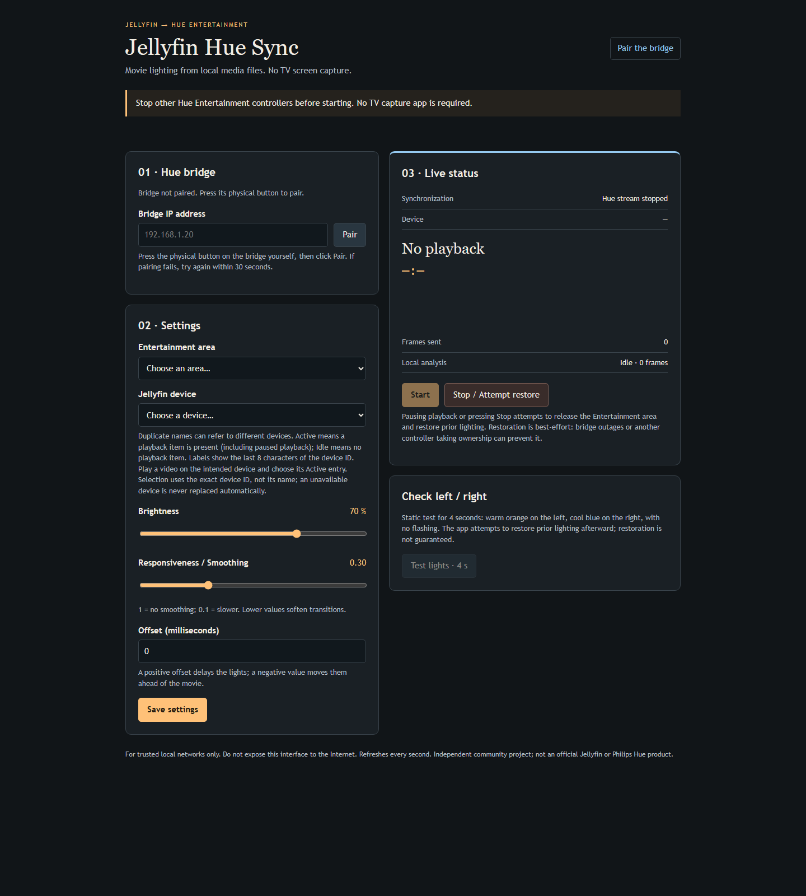

# Jellyfin Hue Sync

**Movie-driven Philips Hue lighting, analyzed on your Jellyfin server — no TV screen capture.**

An independent, self-hosted service that follows one Jellyfin client, samples colors from the original library file, and streams them to a Hue Entertainment area. Your TV keeps using its normal Jellyfin application. Closing the control page does not stop synchronization.

> **Experimental alpha.** Physical movie synchronization and stop/restoration have been confirmed on one home setup. Other hardware and deployment combinations need beta testing. Passing automated tests is not a compatibility guarantee. This is not an official Jellyfin or Philips Hue product.

## What it does

- Automatically follows the selected client's library-video playback.
- Analyzes small frames on the server and caches current/upcoming segments.
- Maps left/right colors to the light positions in your Entertainment area.
- Supports brightness, smoothing and a playback offset.
- Saves lamp on/off, brightness and color before taking over; attempts restoration on pause/stop.
- Refuses an area observed as occupied by another application. Ownership checks are best-effort; do not run competing controllers on the same area.
- Offers an English trusted-LAN setup/status interface.

## What it does not do

This is **not** a Sync Box replacement for every TV source. It does not capture Netflix, YouTube, consoles, desktop apps or DRM screens. This version is designed for normal-speed Jellyfin library videos whose source files are accessible to the analysis host. Live TV, arbitrary remote streams, multiple simultaneous rooms and broad codec/GPU compatibility are not established.

Sampling is two-zone ambient lighting, not per-lamp pixel-perfect screen reconstruction. Extra decoding consumes server resources; an overloaded server can still affect playback. Hardware acceleration and HDR appearance depend on your actual media and GPU.

## Requirements

- A Linux analysis host with Python 3.11+, Java 21+, Docker and readable library files.
- A reachable Jellyfin server and a locally stored Jellyfin API key.
- A square Hue Bridge v2 (BSB002), color-capable lamps, and a configured Entertainment area.
- A trusted local network connecting the analysis host and bridge.
- An existing compatible Jellyfin FFmpeg container image on the host. Analysis reuses a pinned image; it does not update or restart Jellyfin.

Node is needed for UI **development tests**, not normal Python/Java service execution. Windows development test results do not establish Windows as a production extraction host.

## Build and test

```bash
git clone https://github.com/Mbappinho/jellyfin-hue-sync.git
cd jellyfin-hue-sync
python transport/build.py --test
python transport/verify_dist.py
python -m unittest discover -s tests -v
```

Builds download checksum-locked Bouncy Castle dependencies from Maven Central. Generated jars/classes and private state are not committed. Set `JAVA_HOME` if Java 21+ is not on PATH. The transport tests use a local DTLS test server, not your bridge.

For installation and a boot-enabled Linux service, see [installation](docs/installation.md). Check the CLI's `--help` for the installed revision's arguments; never put an API key in a command-line argument.

## Control interface



This screenshot shows the real English page with empty fixture data. It does **not** show a connected bridge, physical lamp synchronization or measured timing.

## First setup

1. Open the control page from the trusted LAN or loopback address you configured.
2. Stop other Hue Entertainment streamers, press the physical bridge button, and pair.
3. Select your Entertainment area and the exact Jellyfin client. Start playback while choosing so the active entry is identifiable; display names can be duplicated.
4. Run the four-second static light test and check that lamp settings return afterward.
5. Enable synchronization once. Subsequent playback start, pause/resume and stop are followed automatically.

Expect a preparation delay for uncached positions. A seek can temporarily release lights while the next segment is prepared. With sync disabled or no valid playback, the service waits instead of continuously driving lamps.

## Security

**The web interface has no login. Keep it off the Internet.** Host/Origin/CSRF checks are not authentication. Anyone allowed to reach it can control the selected lamps and see public playback metadata. Do not port-forward it or publish it through a tunnel.

The service needs Docker access, which is typically root-equivalent. Its read-only, network-isolated analysis container does not remove the parent daemon's privilege. Read [security](SECURITY.md) before deploying.

## Evidence and beta testing

See [validation](docs/validation.md) for the actual tested setup, acceptance checklist and limitations. We need reports from other setups, not assumptions based on builds. Use the beta report issue template and never upload credentials or copyrighted source media.

No physical demonstration video has been recorded for this release. [Demo recording instructions](docs/demo.md) explain how to produce one honestly; UI screenshots are not a substitute for actual lamp footage.

## Development and design

- [Architecture](docs/architecture.md)
- [Transport protocol](transport/README.md)
- [Contributing](CONTRIBUTING.md)
- [Security](SECURITY.md)
- [Acknowledgements](ACKNOWLEDGEMENTS.md)

AI-assisted development was used. The code has automated tests, but generated code and documentation can still contain mistakes. Human review, reproducible reports and limited claims are intentional.

## Support

If this project is useful to you, you can [support its development on Ko-fi](https://ko-fi.com/mbappinhoo).

Donations are optional. The project remains free and open source under the MIT license; donating does not purchase support, compatibility guarantees, or priority access.

## License

Project source is published under the [MIT license](LICENSE). Third-party dependencies retain their own notices; see [third-party notices](THIRD_PARTY_NOTICES.md). Jellyfin, Philips Hue, Bouncy Castle and other product names belong to their respective owners. This project is unaffiliated with their vendors.
