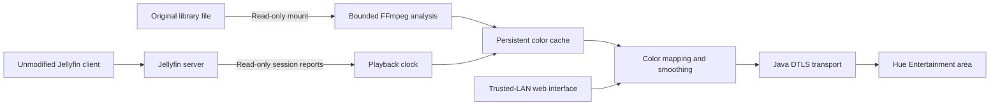

# Architecture

Jellyfin Hue Sync is an independent server service, not a Jellyfin plugin and not a TV screen recorder.

## Reading playback

The Python service requests Jellyfin sessions and selects the configured exact DeviceId. Display names are not unique: the same TV can have stale entries with identical names. Playback reports establish a monotonic clock; repeated reports do not pin the clock to one timestamp. Missing sessions, pauses and stale reports stop dispatch.

This version targets normal-speed playback of local library items. A session must expose a source path and playback position. Live TV, arbitrary network streams, third-party streaming apps and generalized variable playback speed are not established use cases.

## Acquiring colors

FFmpeg runs in a separate Docker container, not inside the Jellyfin playback container. The analysis container has no network access, mounts the library read-only, drops capabilities and has resource limits. It decodes small 96-by-54 RGB frames at four samples per second. VAAPI can be used when available; CPU decoding is an alternative. HDR transfers identified by Jellyfin metadata use a tone-mapping filter chain; format-wide HDR or Dolby Vision accuracy is not certified.

Each 30-second segment stores left/right average colors. The current and following segment are prepared asynchronously. Near-black outer borders are trimmed within bounded limits. The cache key incorporates the source identity and metadata. Managed chunk files have 64 MiB and 4096-file budgets; the requested current/next chunks are protected during eviction. Unrelated files are not part of that quota. There is no whole-library scan on startup.

The analysis is independent of playback, but it still consumes server resources and may compete with transcoding on a busy or underpowered host. There is no universal no-lag guarantee.

## Mapping colors

Lights with negative horizontal coordinates use the left sample, positive coordinates use the right sample, and centered lights average both. This is two-zone ambient lighting, not a separate pixel sample per lamp. Brightness and exponential smoothing apply before encoding. The web API uses RGB8; HueStream frames expand each channel to RGB16.

## Owning and restoring lamps

The bridge button creates local credentials and an Entertainment PSK. Before activating an unoccupied area, the service snapshots its lamps' on/off state, brightness and active color representation, then writes a private recovery journal. REST handles association, ownership and restoration; continuous colors travel over DTLS.

The service refuses an already occupied area and checks ownership before release/restoration. These checks are best-effort: the REST read and update are separate requests, so a competing controller can take ownership between them. Do not run concurrent controllers on the same area. This is not a guarantee of atomic handover or race-free foreign-stream protection.

Pause, missing playback, cache misses, explicit stop and orderly shutdown release the stream and attempt restoration. Bridge/network failures retain recovery state where possible; do not delete a journal to force a connection.

Restoration is a snapshot of individual lamp attributes, not a saved Hue scene, automation or dynamic effect. It cannot recreate arbitrary third-party effect state. A network outage may delay restoration until communication returns.

## Controls and process lifetime

The UI sets preferences; closing the browser does not stop the daemon. Enabled means armed to follow the selected client, not streaming continuously. Start/stop preference and setup are saved in private state. The Linux service can be enabled at boot independently of Jellyfin.

Before reading or recovering private state, the daemon acquires a kernel-backed exclusive lifetime lock. A second instance using the same directory is rejected. Shutdown cancels future dispatch before cleanup; a timed-out or failed cleanup is reported rather than treated as success. Do not delete the lock file to bypass a running instance.

Jellyfin replies have an absolute socket deadline. HTTP control requests have a 15-second socket deadline and a 16-worker admission limit. These bounds do not forcibly cancel every OS/filesystem call or a blocked engine operation. Extraction deadlines terminate the local Docker CLI and attempt to kill its container; if the daemon does not answer, an orphaned remote container may remain.

The HTTP interface checks Host, Origin and CSRF and bounds inputs. These protections are not user authentication. It belongs on a trusted LAN or loopback, never an Internet-facing reverse proxy.
